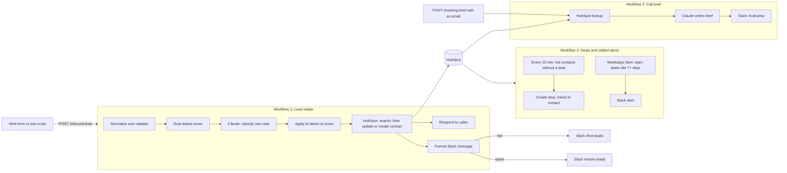

# Inbound Lead Engine

This is a portfolio project I built to explore what workflow automation and AI-assistance look like in a real sales process, developed with Claude as a pairing partner.

It is an automated pipeline that takes an incoming sales lead from a web form, assesses how promising it is, and routes it to the right person with the reasoning attached. It runs on n8n, HubSpot, Slack and Claude.

The question behind it: **when a lead comes in, how likely is it to be worth a salesperson's time, and can I explain why?** That second half shaped almost every decision below.

> Everything here runs on synthetic data, and the scoring weights are my own judgement, not calibrated on real conversions. I am upfront about what that means in [What I would do differently](#what-i-would-do-differently).

---

## What it does

A lead arrives through a webhook. From there:

1. **Capture.** The data is cleaned and malformed emails are rejected.
2. **Qualify.** Fit (who they are) and intent (what they want) are scored. Claude reads the free-text use case and labels it. Every point is logged with a reason.
3. **Record.** The contact is created or updated in HubSpot, deduplicated by email.
4. **Route.** Hot leads post to Slack with the full score breakdown and a draft first reply. Warm leads get a one-line post.
5. **Engage.** Hot leads automatically get a deal in HubSpot.
6. **Meet.** Give it a contact's email and it posts a one-page call prep brief to Slack.
7. **Close.** Every weekday morning it lists open deals that have gone quiet for a week.

## Architecture



The project splits into separate workflows, one per job, so a problem in one doesn't take down the others.

## The decisions I am happiest with

**Explainable scoring.** Every point goes into a `score_breakdown` list with its reason, like `+25 company size (5000+)`. A salesperson can see why a lead scored the way it did, and I could trace any wrong score to its cause.

**Claude labels, rules score.** The model never picks a number. It returns fixed labels (problem type, data type, use-case clarity, buying signal, existing-user signal), and a table I wrote turns them into points. Structured fields like company size and job title use plain rules, so Claude handles only the free text.

**It keeps working when the AI doesn't.** If the Claude call fails, runs out of credit or returns nonsense, the lead keeps its rule-based score, and the Slack post and HubSpot record say so. This happened when my API credit ran out, and no leads were dropped.

**Safe by design.** A person reviews drafted emails, and nothing is sent automatically. Claude sees only first name, title, company, size, industry, use case and timeline, never an email address or last name. Lead text is treated as data, not instructions, and everything is escaped before it reaches Slack, so a crafted submission can't trigger an `@channel` ping or plant a fake link.

**Safe to resend.** Contacts are looked up by email and deals by name before anything is created, so a repeat submission updates the existing record.

## Scoring dimensions

| Part | Max | How |
|---|---|---|
| **Fit** | 60 | Company size up to 25. Priority industry 15. Senior title 10. Data or ML title 10. |
| **Intent** | 40 | Six signals, detailed below. |
| **Penalty** | -15 | Personal email domain like gmail.com. Reduced to -5 when the use case shows strong intent. |

**Tiers:** hot at 75 or more, warm at 35 to 74, cold below 35, invalid for a malformed email.

### Intent signals

| Signal | Labels and points | Max |
|---|---|---|
| Problem type | Core use case 10, other ML 4, non-ML or unclear 0 | 10 |
| Data type | Fits the product's data 6, other or unknown 0 | 6 |
| Use-case clarity | Specific 4, vague 1, none 0 | 4 |
| Buying signal | High 5, medium 2, low 0 | 5 |
| Timeline | Within 3 months 15, 3 to 6 months 8, exploring 2 | 15 |
| Existing user | Already using or testing the product +10 | 10 |
| **Total** | Capped at 40 (the signals add up to 50) | **40** |

The first four signals come from Claude's labels. Timeline comes from the form. The existing-user bonus is a yes or no from Claude. If the first four total 15 or more, the personal-email penalty drops from -15 to -5.

## Use case example: a strong lead on a personal email

This is the case that taught me the most about the project, and it shows how the pieces fit together.

**The situation.** An engineer fills in the form with a Gmail address and leaves the company and industry blank. In the use-case box they write that they want to try the product on a classification dataset. On paper this is an anonymous hobbyist. In practice it is someone actively evaluating the product, exactly the lead a salesperson would want to hear about.

**Challenge 1: rules alone under-scored them.** The keyword rules gave no points for company size or industry, took the full -15 personal-email penalty, and could only match a few keywords in the use case. Score: **9**, firmly cold. Rules can't read intent, which is why I added the AI step.

**Challenge 2: the first AI version still missed them.** Claude's labels lifted the score, but only to **27**, still cold. I opened the score breakdown and spotted the cause: the `+10 already using or testing our product` line was missing, because Claude had returned `existing_user_signal: false`.

**Why it happened.** Two flaws in my first prompt:
1. It never said what the product was, so the product's name in the lead's text meant nothing to the model.
2. I had defined the signal as "already use or are testing", which does not clearly cover "want to try".

**The fix.** I described the product in the prompt and widened the definition to include trying or planning to try it. I also added a guard so that mentioning only a competitor's tool does not earn the bonus.

**The result.** The lead moved to **37**, warm, with the personal-email penalty reduced to -5 because the use case showed strong intent. The breakdown now shows every step that got them there.

**What it means for reuse.** The mechanism isn't specific to one product, but my version is tuned to mine. The product description and the definition of each signal live in the Claude prompts (`Build AI Request` and `Build Brief Request`). The fit rules (priority industries, data or ML title), the rules-only keyword list and the label names (for example the problem types) were also written for my product. A different business would rewrite those and set its own point values. The rest of the pipeline stays as it is.

## What I learned

**Test an LLM classifier on cases you already know the answer to.** The model wasn't the problem. My definition was ambiguous, and a lead with a known answer exposed it.

**Logged reasons make bugs quick to find.** Because every point had a reason, the missing bonus in the example above showed up in seconds.

**Let the model judge, and let code do the arithmetic.** Splitting labelling from scoring made the system predictable and the failures traceable.

**Test credentials outside the tool.** A plain `curl` call proved the key was fine and the problem was how n8n sent it. Sending it as a Bearer token through a generic Header Auth credential fixed it.

**Real APIs behave differently from mock data.** HubSpot rejected `.example` email domains, caps search at about 5 requests a second (so I batched the lookups), and lags a few seconds behind new records. My mock-data tests caught none of this.

**A green node doesn't prove it worked.** A node that outputs nothing stops the flow silently. "Create Deal" skipped only because the dedupe had found every deal already existed. I now check item counts on each node.


## What I would do differently

**Calibrate on real outcomes.** My scoring weights come from judgement, and synthetic leads show the method works, not that the scores predict revenue. With real data I would log won/lost outcomes and retune.

**Store the lead's own words in HubSpot.** I only keep the AI's one-line summary, so call briefs are thinner than they could be.

**Alert on changes, not every submission.** Slack currently posts every time a lead comes in, including repeats.

**Match deals by ID, not name.** If someone renames a deal, my current dedupe creates a second one.

**Make deal creation event-driven.** It polls every 15 minutes, so a hot lead can wait up to 15 minutes for its deal.

**Add proper error handling.** A HubSpot failure currently returns a 500 with no retry queue.

## Setup

### Prerequisites
- Docker (or Node) to run [n8n](https://n8n.io)
- Node 18 or newer, for the test script
- A free [HubSpot](https://www.hubspot.com) account
- A Slack workspace
- An [Anthropic API](https://console.anthropic.com) key with credit (a Claude.ai subscription doesn't include API credit)

### 1. Run n8n
```
docker run -it --rm -p 5678:5678 -v n8n_data:/home/node/.n8n docker.n8n.io/n8nio/n8n
```
Keep the `-v` volume, or your workflows and credentials disappear when the container stops. Open http://localhost:5678 and create the owner account.

### 2. HubSpot
1. Create a **service key** (Settings, Integrations, Service Keys) with the scopes `crm.objects.contacts.read`, `crm.objects.contacts.write`, `crm.objects.deals.read` and `crm.objects.deals.write`.
2. Create four contact properties by hand:

| Label | Internal name | Type |
|---|---|---|
| Lead Score | `lead_score` | Number |
| Lead Tier | `lead_tier` | Single-line text |
| Score Breakdown | `score_breakdown` | Multi-line text |
| Lead Source | `lead_source_form` | Single-line text |

### 3. Slack
Create a Slack app with the bot scopes `chat:write`, `channels:read` and `groups:read`. Install it, copy the `xoxb-` token, create `#hot-leads`, `#warm-leads` and `#call-prep`, and invite the bot to each with `/invite @YourApp`.

### 4. n8n credentials
Create two **Header Auth** credentials, with clear names, since both appear in every dropdown.

| Credential | Name | Value |
|---|---|---|
| HubSpot Key | `Authorization` | `Bearer ` followed by the service key |
| Anthropic API Key | `x-api-key` | The key alone, with no `Bearer ` prefix |

Then create a **Slack API** credential with the bot token.

### 5. Import the workflows
Import each file from `workflows/`, leaving out the `archive/` subfolder (three-dot menu, Import from File), then:
- select the HubSpot credential in every HubSpot node, the Anthropic credential in the Claude nodes, and Slack plus a channel in each Slack node;
- paste your HubSpot Hub ID (the number in your HubSpot URL) into the `PORTAL_ID` line of the nodes that build Slack messages, for working "Open in HubSpot" links;
- edit the `PRODUCT` text in the Claude prompt nodes so it describes what you actually sell.

| File | Purpose | Path or trigger |
|---|---|---|
| `lead-intake.json` | Lead intake, scoring, AI, HubSpot, Slack | `POST /webhook/inbound-lead` |
| `call-brief.json` | Call prep brief | `POST /webhook/meeting-brief` |
| `deals-and-stalled.json` | Deals for hot leads, stalled-deal alerts | Every 15 minutes, weekdays 9am |
| `archive/` | Earlier versions of lead intake, kept as history | Same path as `lead-intake.json` |

**Import only `lead-intake.json`, not the files in `archive/`.** The earlier versions listen on the same `/inbound-lead` path, and n8n refuses to publish a second workflow on it.

### 6. Run the test
```
node scripts/send-test-leads.mjs
```
Each line shows the tier, score, HubSpot action (`created`, `updated` or `skipped`) and AI status (`ok` or `fallback`). Wait about 10 seconds and run it again. HubSpot should show the same number of contacts, with every action reading `updated`.

To try a call brief for an existing contact:
```
curl -X POST http://localhost:5678/webhook/meeting-brief \
  -H "Content-Type: application/json" \
  -d '{"email":"anna.keller@nordsee-versicherung.example.com","meeting_time":"Tue 14:00","notes":"Asked about pricing"}'
```

## Privacy and security
- API keys live only in n8n's credential store. Exported workflow files contain credential names, never secrets. I search every export for `sk-ant-` and `xoxb-` before committing.
- Email addresses and last names never go to the model.
- The test leads use `example.com` domains, which are reserved for documentation, so no real person can receive anything.
- Nothing in the pipeline deletes or merges data in HubSpot.

## Repository layout
```
inbound-lead-engine/
├── README.md
├── .gitignore
├── workflows/        # n8n workflows
│   └── archive/      # earlier iterations, history only
└── scripts/
    └── send-test-leads.mjs
```
